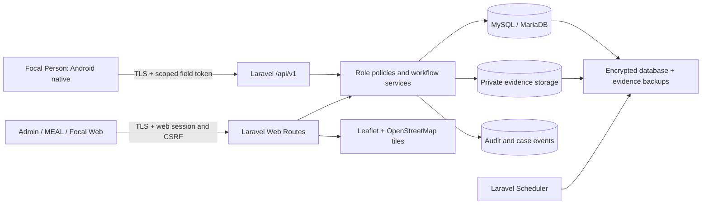
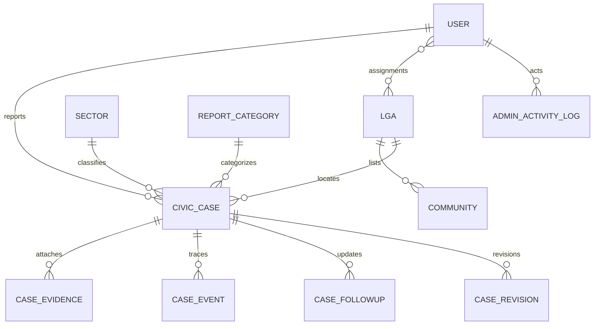

# Arewa Civic Tracker
## System Architecture and Technical Design | Baseline v1.0

**Client:** RAWYOD | **Prepared by:** InnoBytes Lab LTD  
**Date:** 29 October 2026 | **Status:** Complete engineering design, subject to client acceptance  
**Basis:** EOI sections 3, 5 and 6; InnoBytes Technical Proposal pp. 10 to 13; implemented source and native Android app v0.3.1.

### 1. Scope and components
The staging portal is https://arewa.kasua.ng. This is not a declaration of final production hosting. The system is a server-authoritative Laravel application with a role-aware Blade web interface and a separate Kotlin/Jetpack Compose field client.

In staging, files use private local storage. Cloudflare R2 adapter code is prepared but **not activated**. A separately hosted backup destination is not yet configured. Neither condition blocks the implemented application features.

### 2. Application layers
| Layer | Implementation | Responsibilities |
|---|---|---|
| Presentation web | Laravel Blade, locally served CSS/JavaScript, SweetAlert2, searchable select controls and Chart.js | Role-aware forms, state feedback, responsive analytics and accessibility |
| Reporting and review | CaseController, CaseRevisionController, CaseReviewService, CaseClosureService, CaseSubmissionService | Business rules, idempotency, versioning and case workflow |
| Analytics | ReportsController, ReportChartRenderer, MapController | Authorized aggregates, community/LGA grouping, PDF charts, Excel and CSV exports, geographic data |
| Reference administration | ReferenceDataController, SectorController and UserController | LGA, community, category, status-label, sector and account administration |
| Security boundary | Laravel sessions, policies, password rules, TOTP, Sanctum field tokens and rate limits | Server-side authorization for every submitted action |
| Data storage | Relational database + private file storage | Cases, attachments, reference data, people, audit history |
| Mobile native | Kotlin/Jetpack Compose, Room, Android Keystore AES-GCM, WorkManager, OkHttp | Offline creation, encrypted persistence, evidence capture and reliable resend |
| Recovery and governance | Scheduler, GPG-encrypted snapshots, backup verification, isolated restore, legal holds and policy records | Integrity and controlled recovery without automatic irreversible deletion |

### 3. Conceptual database model

Key entities are `users`, `lgas`, `sectors`, `communities`, `report_categories`, `workflow_status_labels`, `civic_cases`, `case_evidence`, `case_events`, `case_followups`, `case_revisions`, administrator activity logs, review assignments/notifications and governance-policy data. The authoritative physical schema is in `database/migrations/`. Foreign keys use stable record IDs; renaming an LGA does not change historical case or focal-assignment IDs. Changing an official name requires confirming the separate GIS boundary label mapping.

`civic_cases` includes reporter, unique client submission identifier, server reference, type, location, community, sector, category, observation details, progress state, verification state, review assignment, optional coordinates and lifecycle metadata. Audit history stores distinct submissions, reviews, amendments, progress changes and closure events rather than overwriting all previous context.

### 4. HTTP interfaces
**Web:** `/login`, `/dashboard`, `/cases`, `/cases/new`, `/cases/{case}`, `/reviews/queue`, `/reports/analytics`, `/reports/export.xlsx`, `/reports/export.pdf`, `/cases/export.csv`, `/map`, `/map/data`, `/admin/users`, `/admin/reference-data`, `/admin/sectors`, `/admin/activity`, `/admin/data-governance`.

**Native API (prefix /api/v1):**
| Method | Path | Function and boundaries |
|---|---|---|
| POST | /login | Field-only credentials; optional TOTP challenge; rate-limited |
| POST | /login/verify-otp | Complete active two-factor challenge |
| POST | /logout | Revoke current field token |
| GET | /bootstrap | User assignment, sectors, categories, communities, status labels and evidence limits |
| GET | /reports | Recent reports owned by authenticated focal user |
| GET | /reports/{case} | Read owned case fields and current revision version |
| POST | /reports | Submit version-stable report and evidence |
| PUT | /reports/{case} | Reasoned update with optimistic conflict control |
| POST | /reports/similar | Online, nonblocking duplicate suggestions |
| POST | /reports/{case}/clarification | Reply to pending clarification on same case |
| GET | /evidence/{evidence} | Download evidence of an owned case |

The public route `GET /download/android` is intentionally unauthenticated and throttled. It downloads the APK artifact only. It does **not** give the public access to the protected data API.

### 5. Offline submission and conflict sequence

```mermaid
sequenceDiagram
  participant P as Focal Person
  participant A as Native Android
  participant Q as Encrypted Room + Files
  participant S as Laravel API
  P->>A: Record project or issue
  A->>Q: Store draft and stable client UUID
  Note over A,Q: Offline and after app restart
  A->>Q: Claim pending item when network returns
  A->>S: POST report + UUID + evidence
  alt New valid report
    S-->>A: 201 + case reference
  else Retry of same submission
    S-->>A: Existing case reference
  else Validation, permissions or expired token
    S-->>A: Error requiring user action
  end
  A->>Q: Retire only confirmed successful item
```

All final authorization is enforced on the backend at synchronization time. The mobile application must not discard an encrypted draft solely because the network is unavailable or the current token expires. Android Keystore invalidation, uninstalling, clearing app data and device loss are explicit limits of device-only offline persistence. Offline content similarity cannot be confirmed without an API connection.

### 6. State, labels and data access
Verification and progress are stored as immutable machine codes rather than presentation strings. `workflow_status_labels` maps those codes to administrator-customized labels in dashboards, case lists, filters, charts and exports. Changing a display label **never** changes legal transitions or permissions. Case closure is distinct from verification and progression. Review approval is not evidence that a public project was completed.

Backend reporting starts from `CivicCase::visibleTo(user)`, then applies LGA/community/sector/date/type/status filters. Community aggregation groups by **both LGA ID and normalized community name**, avoiding accidental merging of identically named communities in different districts. Detailed PDF and Excel exports reuse the authorized filter scope.

### 7. Security, privacy and operations
- Web: authenticated sessions, CSRF protections, password hashing, role policies, TOTP support and scoped administrative routes.
- Mobile: time-bounded Sanctum tokens and field-only abilities, rate limits, private local encryption and TLS.
- Data: server-side validation, private evidence permissions, bounded evidence counts and sizes, audit events and legal holds.
- Map: report coordinates disclosed only to authenticated authorized users. Reports with no GPS remain accessible in registers.
- Database and files: encrypted snapshot generation and SHA-256 verification, protected backup directory and non-destructive isolated restoration.
- Governance: retention policy drafts and approval references can be recorded, but report and evidence erasure is not automatically activated.
- Failure handling: resilient native retries with explicit failed/pending statuses, error feedback and no assumed automatic offline uploads.

### 8. Scalability, deployment boundaries and change control
The first operational target is 34 field focal persons, RAWYOD supervisors and 17 LGAs. Indexed and paginated result sets, filtered map responses, on-demand PDF/Excel generation and compressed photos limit resource demand. No throughput, uptime or production load claim is made without later performance testing.

Production TLS, environment secrets, signed APK key custody, off-server backup credentials, RAWYOD-controlled deployment and data-retention decisions are later-phase or client-dependent controls. Technical design baseline is complete; formal operational acceptance remains separate.
